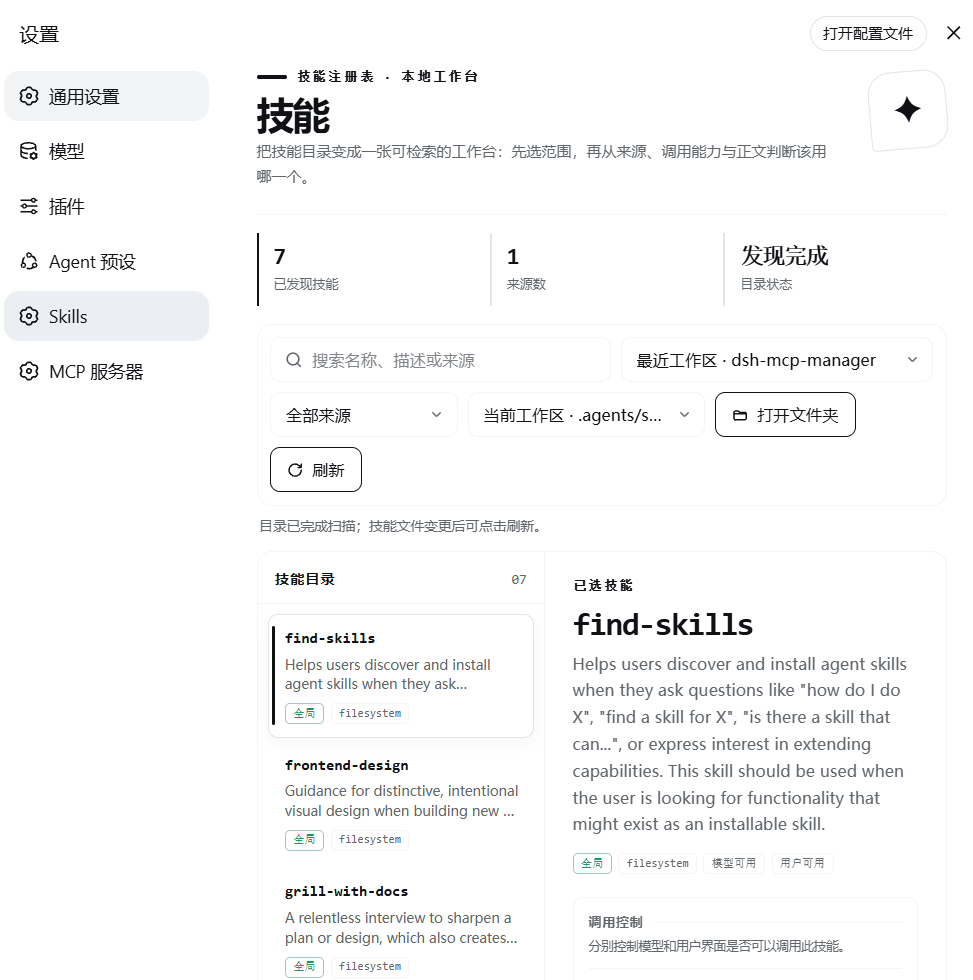
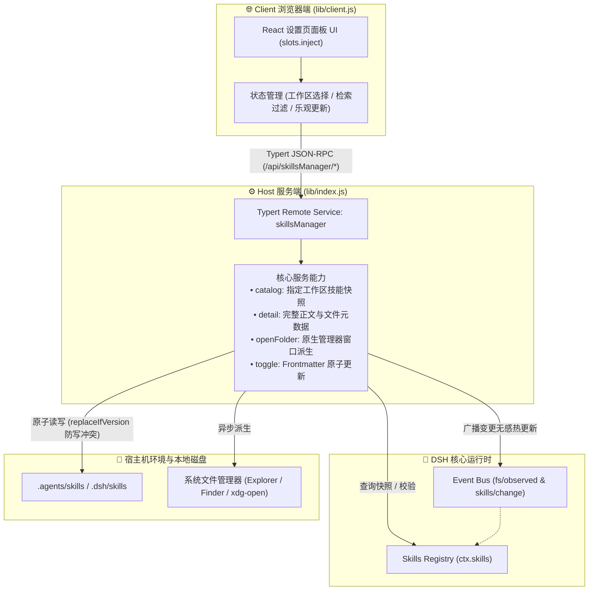

<div align="center">

# 🤹 dsh-skills-manager

<p align="center">
  <strong>DeepSeek Harness (DSH) 可视化 Skills 技能目录管理与配置面板插件</strong><br>
  <em>A modern visual dashboard & control panel for DeepSeek Harness (DSH) Skills registry.</em>
</p>

[](package.json)
[](LICENSE)
[](https://github.com/deepseek-ai)
[](https://cordis.moe/)
[](#)
[](#-参与贡献与反馈)

<p align="center">
  <a href="#-为什么需要本插件">项目背景</a> •
  <a href="#-界面预览">界面预览</a> •
  <a href="#-核心特性">核心特性</a> •
  <a href="#-快速开始">快速开始</a> •
  <a href="#-skills-规范与编写指引">编写规范</a> •
  <a href="#-架构与工作原理">系统架构</a> •
  <a href="#-常见问题-faq">常见问题</a> •
  <a href="#-开发与构建">开发构建</a>
</p>

---

</div>

## 💡 为什么需要本插件？

DeepSeek Harness (DSH) 拥有强大且灵活的分层 Skills 扩展机制（涵盖项目级、用户个人级、系统内置及运行时动态注册）。但在原生环境的实际使用与 Agent 技能调优中，开发者往往面临以下痛点：

| 痛点场景 | 原生 DSH 现状 | 搭配 dsh-skills-manager ✨ |
| :--- | :--- | :--- |
| **技能全貌感知** | 依赖 CLI 命令行或排查日志，无法直观掌握当前工作区生效了哪些技能 | **仪表盘全景总览**：多工作区自动聚合汇总、实时命中计数与分层统计一目了然 |
| **快速检索与定位** | 无法直接按触发场景或正文模糊检索，定位具体技能耗时 | **即时模糊过滤**：支持对名称、描述、`whenToUse`、来源与 Provider 毫秒级检索 |
| **指令与正文预览** | 需深入项目隐藏目录（如 `.agents/skills`）手动翻找并打开 `SKILL.md` | **内置 Markdown 检查器**：原生等宽排版直接预览完整 Prompt、工作流与元数据 |
| **调用权限治理** | 调整技能权限需手动编辑物理文件并逐一修改 YAML Frontmatter | **可视化双向开关**：直观切换「模型自主推理」与「用户显式调用」，带并发防冲突校验 |
| **维护本地技能** | 手工寻找并打开多层级技能目录步骤繁琐 | **原生文件管理器联动**：一键唤起系统资源管理器（Windows / macOS / Linux），缺省目录自动建立 |

---

## 📸 界面预览

<div align="center">
  
  <br />
  <sub><b>🤹 技能注册表 · 本地工作台</b>：多工作区范围切换、即时关键词检索、来源分面过滤、双栏技能检查器、调用控制开关与文件/文件夹免限制上传</sub>
</div>

---

## ✨ 核心特性

### 🎯 1. 多工作区智能透视与聚合
- **智能范围切换**：支持快速切换「最近工作区」、「全部全局技能」以及会话历史中任意登记的项目工作区。
- **多源自动聚合**：统筹汇总项目级（`.agents/skills`、`.dsh/skills`）、用户全局级（`~/.agents/skills`、`~/.dsh/skills`）、系统内置（`bundled`）与动态注入（`runtime`）技能。

### 🔍 2. 多维即时检索与分面过滤
- **实时模糊匹配**：输入关键词即刻在技能名称、描述、适用时机（`whenToUse`）、来源（Source）与提供方（Provider）间极速检索。
- **分面来源过滤**：一键按全部来源、项目专用、全局通用、系统预置、运行时注入等分类精准下钻。
- **交互式徽章与重置**：检索命中数与总数比率动态更新，支持搜索关键词 Chip 标签一键清除与全部筛选重置。

### 📖 3. 深度详情检查器（Inspector）
- **完整元数据透视**：清晰展示 Provider、来源分类、物理文件绝对路径、资源基目录（本地目录 / URL / 描述）。
- **适用场景重点高亮**：独立板块醒目展现 `whenToUse` 触发时机建议，便于辅助评估大模型路由意图。
- **Markdown 等宽排版预览**：无需离开设置界面，以舒适的等宽字体即时预览完整 Prompt 指令与工作流程。

### 🎛️ 4. 粒度化双向调用控制（Invocation Switches）
- **模型自主调用开关**（`disable-model-invocation`）：控制大模型在规划推理时能否自主感知并触发该技能。
- **用户显式调用开关**（`user-invocable`）：控制用户能否在前端对话交互界面中手动调用该技能。
- **只读安全沙箱**：内置（bundled）或运行时动态技能自动禁用开关并置灰，严防误操作破坏核心能力。
- **乐观更新与防写冲突**：切换开关前端立即响应；服务端基于文件修改版本（`replaceIfVersion`）严格比对，在外部文件被抢占编辑时及时报错拦截，保护数据完整性。
- **事件总线无感广播**：写入成功后实时向 DSH 触发 `fs/observed` 与 `skills/change` 事件，正在运行的模型规划器无缝刷新生效。

### 📤 5. 文件与文件夹免限制上传（组合按钮）
- 支持在 Web 设置页面板直接点击「上传文件」，并通过下箭头下拉菜单快速选择「上传文件夹」。
- **文件类型不设限制**（支持 Markdown、各类脚本代码、配置文件及多媒体资源）。
- 上传文件夹时自动保留完整子目录层级结构，精准部署至选定的项目或全局技能目录。
- 上传完成后自动触发目录热重载与刷新，新技能即刻生效。

### 🎨 6. 原生 DSH 设计语言自适应
- 深度适配 DSH 官方设计规范，基于 `--dsw-alias-*` 系列主题变量构建，**无缝支持浅色（Light）与深色（Dark）主题自适应**。
- 零额外厚重前端依赖，极小体积打包；原生集成 Shimmer 骨架屏加载动画、无障碍属性（ARIA）与自适应移动端布局。

---

## ⚡ 快速开始

### 📋 环境要求

| 运行环境 / 依赖 | 推荐版本 | 说明 |
| :--- | :--- | :--- |
| **Node.js** | `>= 18.0.0` | 支持原生 ESM 与 Child Process |
| **DeepSeek Harness (DSH)** | `>= 0.1.1-rc.2` | 需具备 Cordis 4.x 及 Typert RPC 机制 |

在终端中检查当前 DSH 版本：

```powershell
dsh --version
# 输出示例: 0.1.1-rc.2
```

---

### 🚀 安装方式

#### 方式 A：从 GitHub 安装（推荐日常使用）

无需手动克隆源码仓库，直接使用 DSH 插件管理器一键安装至 `web` profile：

```powershell
dsh plugin --profile web add github:dong152389/dsh-skills-manager
```

> **💡 原理说明**：
> - 本插件为标准 DSH bundle 插件，内置 `cordis.patch.yml` 声明，命令会自动将其安装至 `~/.dsh/profiles/web`（或 `$DSH_HOME/profiles/web`）。
> - 补丁声明中启用了全局 `skill-filesystem` 扫描服务，确保面板能跨越各工作区实时读取技能文件。

#### 方式 B：本地源码开发安装（适用于二次开发与调试）

在本地克隆代码后，编译并以符号链接（`link:`）模式挂载：

```powershell
# 1. 克隆代码仓库
git clone https://github.com/dong152389/dsh-skills-manager.git
cd dsh-skills-manager

# 2. 安装依赖并编译生成 lib 产物
npm run build

# 3. 以符号链接形式挂载到 web profile
dsh plugin --profile web add link:.
```

> **提示**：若需要重新链接或更新路径，可先执行移除再重新添加：
> ```powershell
> dsh plugin --profile web remove dsh-skills-manager
> dsh plugin --profile web add link:.
> ```

---

### 🔍 验证挂载与进入使用

1. **重启 DSH Web 服务**：
   重启正在运行的 `dsh web` 终端进程。

2. **验证配置挂载**：
   在终端执行以下命令，确认插件及文件扫描服务已注入配置树：
   ```powershell
   dsh web --dump-config | findstr /i "skills-manager skill-filesystem"
   ```

3. **进入面板**：
   在浏览器中访问 `http://127.0.0.1:3080`（或你的自定义 DSH 端口），点击左下角 **「设置」⚙️ → 「Skills」** 即可开启管理。

---

## 📝 Skills 规范与编写指引

### 1. 目录结构与层级优先级

DSH 按照就近与覆盖原则从多个目录检索技能，本插件面板可通过「上传文件 / 文件夹」按钮直接部署到目标目录：

```text
📁 工作区根目录 (Project Level)
├── .agents/skills/                   # [推荐] 项目级通用 Agent 技能（project-agents，可编辑）
└── .dsh/skills/                      # 项目级 DSH 专有技能（project-dsh，可编辑）

📁 用户个人主目录 (User Global Level)
├── ~/.agents/skills/                 # [推荐] 用户全局通用 Agent 技能（user-agents，可编辑）
└── ~/.dsh/skills/                    # 用户全局 DSH 专有技能（user-dsh，可编辑）

🔒 系统预置与运行时 (Read-only Level)
└── Bundled / Runtime                 # 系统内部打包或动态注入的只读技能（不可直接编辑）
```

### 2. 标准 `SKILL.md` 模板与 Frontmatter

每个 Skill 建议存放在以技能名命名的独立文件夹中，入口文件为 `SKILL.md`。文件头部必须声明 YAML Frontmatter 元数据：

```markdown
---
name: code-reviewer
description: 在代码合并前执行系统性质量审计、安全漏洞排查与工程最佳实践检查。
when-to-use: 当用户要求代码审查、提交 Pull Request 或排查潜在安全缺陷时使用。
disable-model-invocation: false
user-invocable: true
---

# Code Reviewer Instructions

你是一名高级代码质量与架构安全审计专家。在评审代码时，请遵循以下流程：

1. **架构与边界**：检查模块划分与依赖关系是否合理，是否存在越权或职责模糊；
2. **安全性排查**：确认是否存在注入、明文密钥存储、未授权访问及边界溢出；
3. **性能与测试**：评估关键路径时间复杂度、资源释放与单元测试覆盖度；
4. **反馈格式**：使用 Markdown 分类列出严重程度（P0 / P1 / P2）与可直接套用的修复代码块。
```

### 3. Frontmatter 核心字段一览表

| 字段名称 | 数据类型 | 必填 | 默认值 | 说明 |
| :--- | :---: | :---: | :---: | :--- |
| `name` | `string` | **是** | - | 技能唯一标识符，必须为小写字母连字符形式（**kebab-case**），如 `git-commit-helper`。 |
| `description` | `string` | **是** | - | 技能功能简述，是大模型感知技能能力边界及面板展示的核心描述。 |
| `when-to-use` / `whenToUse` | `string` | 否 | - | 技能触发时机建议。面板会独立高亮呈现，帮助评估模型路由意图。 |
| `disable-model-invocation` | `boolean` | 否 | `false` | 是否禁止模型在自主推理规划中调用该技能。设为 `true` 时模型不会主动调用。 |
| `user-invocable` | `boolean` | 否 | `true` | 是否允许用户在对话交互面板中显式手动调用该技能。 |

---

## 🏗️ 架构与工作原理

插件采用基于 **Cordis** 依赖注入的 Host / Client 双面解耦体系，前后端通过 **Typert JSON-RPC** 严格契约通信：



### 关键技术保障

1. **严格契约注册（Strict Typert Descriptors）**：
   通过 `ctx.typert.register()` 显式注册 `skillsManager` 服务的参数编码与路由描述符，从根本上杜绝 `HTTP 404 / transport failure` 异常。
2. **并发防冲突与版本锁定（replaceIfVersion）**：
   在面板修改调用开关时，服务端通过文件的 `mtimeMs:size` 版本签名进行比对。若磁盘文件在操作瞬间被外部编辑器修改，系统会主动拦截并提示刷新，杜绝无脑覆盖。
3. **事件总线无感广播（Event Bus Invalidation）**：
   成功写回磁盘后，自动向 DSH 触发 `fs/observed` 与 `skills/change` 事件，模型运行时与前端界面无需重启即刻感知最新配置。

---

## 📁 目录结构

```text
dsh-skills-manager/
├── cordis.patch.yml        # DSH Profile bundle 挂载清单（并启用全局 skill-filesystem）
├── package.json            # 插件清单、peerDependencies 声明及构建脚本
├── LICENSE                 # MIT 开源许可证
├── scripts/
│   └── build.mjs           # 极简轻量构建脚本：生成 ESM host 入口与 CJS 懒加载 client
├── src/
│   ├── host.js             # Host 端源码：技能 registry 查询、frontmatter 更新、原生文件夹调起
│   └── client.js           # Client 端源码：React 响应式设置页工作台、主题变量及交互逻辑
├── lib/
│   ├── index.js            # [构建产物] Host 端正式入口（ESM，注册 Typert Remote 服务）
│   └── client.js           # [构建产物] Client 端正式入口（lazy-CJS bundle，注入设置页）
└── README.md               # 项目使用与技术说明文档
```

---

## 🛠️ 开发与构建

本项目避免了庞杂的 Webpack/Vite 捆绑开销，采用纯原生 Node.js 构建链路：

```powershell
# 编译构建到 lib/
npm run build
```

构建脚本会自动：
1. 将 `src/host.js` 同步输出为符合 ESM 标准的 `lib/index.js`；
2. 将 `src/client.js` 封装为适配 DSH 前端 `window.__ModuleLoader__` 的 CommonJS 懒加载模块 `lib/client.js`。

---

## ❓ 常见问题 FAQ

<details open>
<summary><strong>Q1: 安装后在设置页看不到「Skills」菜单？</strong></summary>

1. 确认是否已执行 `npm run build` 生成 `lib/` 下的编译入口文件；
2. 确认插件已成功添加进 web profile（通过 `dsh web --dump-config | findstr skills-manager` 检查）；
3. 重启 `dsh web` 进程，并在浏览器中按 `Ctrl + F5`（macOS 为 `Cmd + Shift + R`）强制刷新缓存。
</details>

<details open>
<summary><strong>Q2: 提示 <code>transport failure for /api/skillsManager/catalog: HTTP 404</code>？</strong></summary>

该问题通常是由于 Typert Remote 描述符未正确注册或版本不一致导致。自 `v0.1.0` 起本插件已采用 `ctx.typert.register()` 严格描述符注册机制。请拉取最新代码重新执行 `npm run build` 并重启 DSH 即可解决。
</details>

<details>
<summary><strong>Q3: 为什么部分技能的调用开关是置灰且不可点击的？</strong></summary>

置灰的技能来源通常标注为 **`bundled`（系统内置）** 或 **`runtime`（运行时动态注入）**。这类技能属于系统只读保护范畴，不对应可变本地磁盘文件。只有来源为 `project-*` 或 `user-*` 的技能支持可视化切换开关。
</details>

<details>
<summary><strong>Q4: 新创建的 Skill 文件在列表中没有出现？</strong></summary>

1. 检查技能文件头部是否包含合法的 YAML Frontmatter（以 `---` 包裹），且必须包含 kebab-case 格式的 `name` 字段和非空的 `description` 字段；
2. 点击面板右上角的 **「刷新」** 按钮主动拉取最新目录快照；
3. 检查 `cordis.patch.yml` 中 `skill-filesystem` 未被意外禁用。
</details>

<details>
<summary><strong>Q5: 保存开关设置时提示“技能文件刚刚发生变化”？</strong></summary>

这是内置的 `replaceIfVersion` 并发保护机制生效的提示。表明该技能的 `SKILL.md` 刚刚在外部代码编辑器（如 VS Code）中被保存。点击面板右上角的「刷新」按钮获取最新状态，然后重新切换开关即可。
</details>

<details>
<summary><strong>Q6: 启动时提示 <code>EADDRINUSE: address already in use 127.0.0.1:3080</code>？</strong></summary>

表示已有后台正在运行的 `dsh web` 实例占用了 3080 端口。可直接复用该服务，或在原终端中按 `Ctrl + C` 终止原有进程后重新启动。
</details>

---

## 🤝 参与贡献与反馈

非常欢迎提交 Issue 与 Pull Request 共同改进本插件！

1. Fork 本仓库并新建分支（`git checkout -b feature/amazing-feature`）；
2. 提交你的修改（`git commit -m 'feat: add some amazing feature'`）；
3. 推送至分支（`git push origin feature/amazing-feature`）；
4. 发起 Pull Request。

---

## 📄 License

本项目采用 [MIT License](LICENSE) 开源协议。
